# Word Cards
Word Cards is a Django web application for creating and managing flashcards.
Allows users to:
- Learn new words with interactive exercises
- Track learning progress

The source placed on render.com - [WordCards](https://word-cards-3yra.onrender.com/)

This project is a continuation of my previous project [WordCards](https://github.com/TMalik26/WordCards)

## Main Features 
- Creating your own user profile (by registration or with Google OAuth)
- Two learning directions: from Ukrainian to English and vice versa.
- Tracks your own results with each topic (percent of correct answers).
- Possibility filtering flash cards topics with category (for example: business, IT, work, etc.).
- Option to repeat cards with mistakes for better retention.

## Screenshots
### Registration & Login
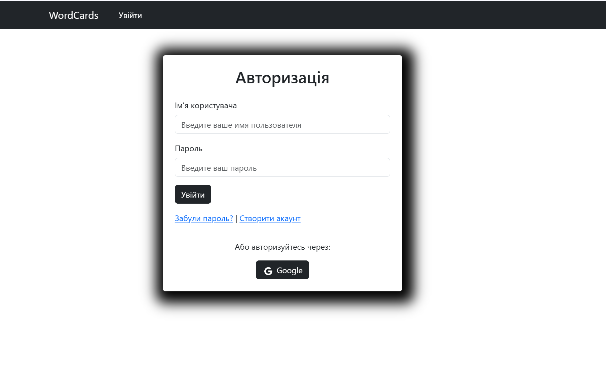
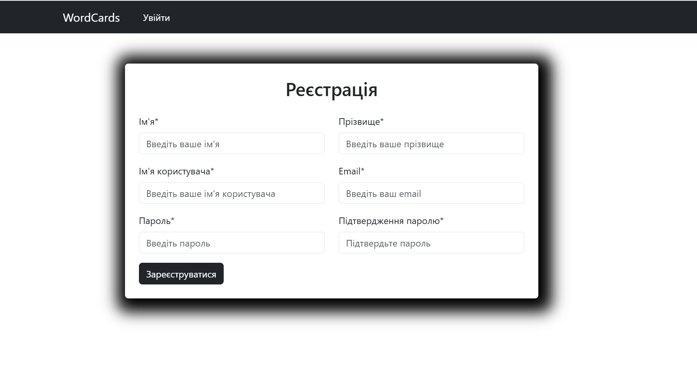

### Main page
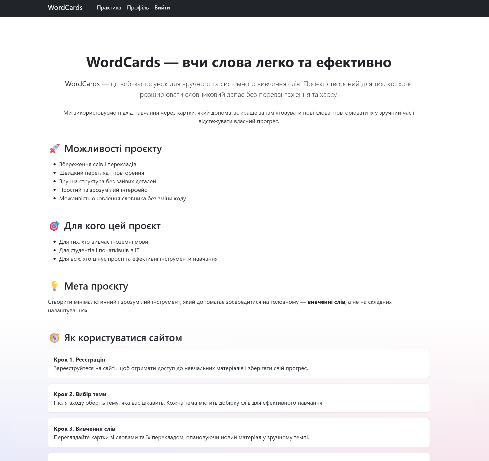

### Categories & Filtering
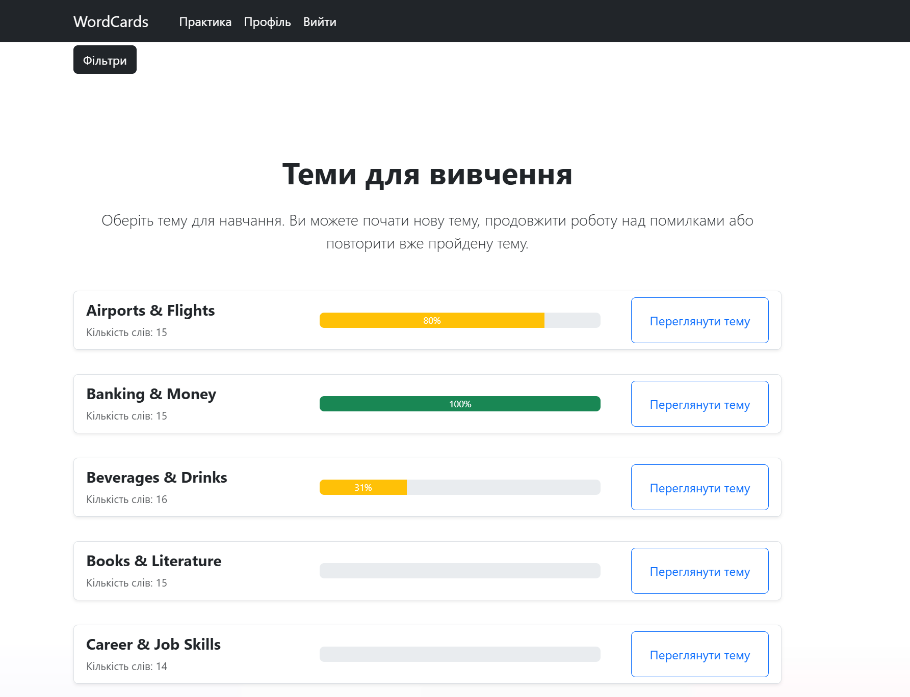
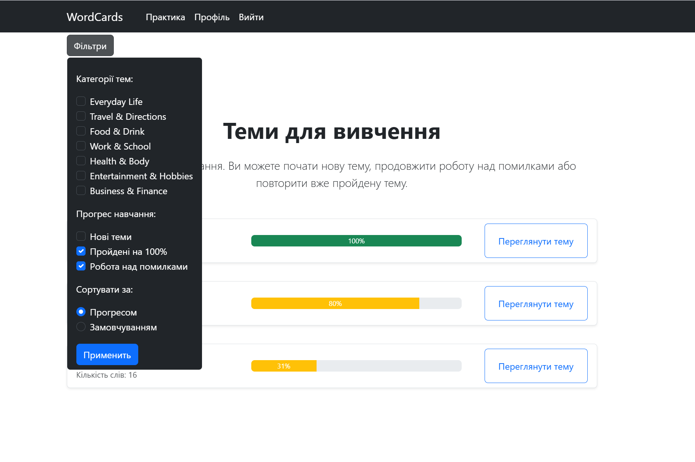
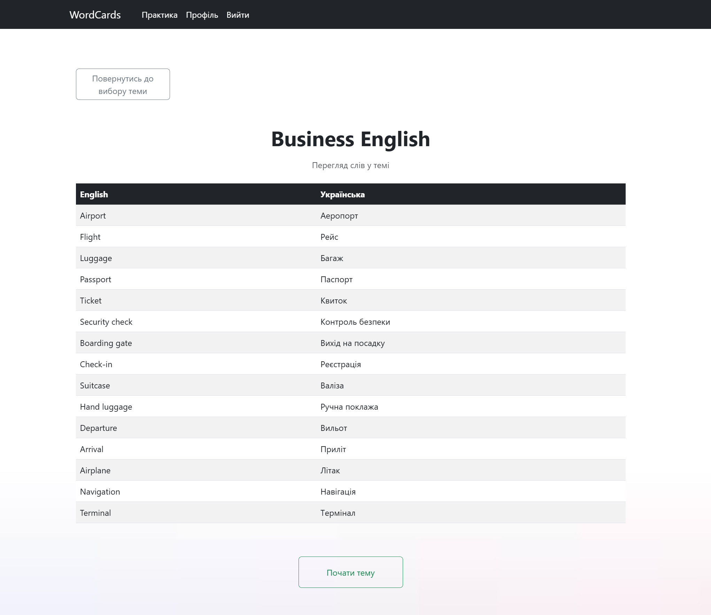

### Learning Interface
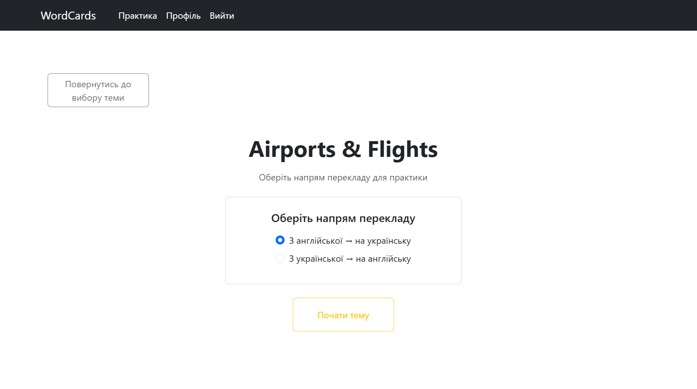
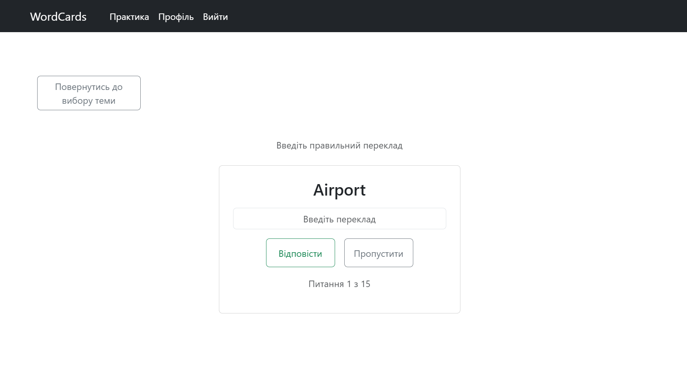
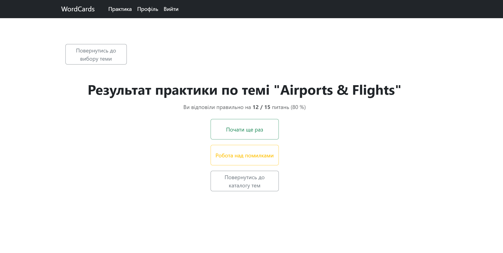
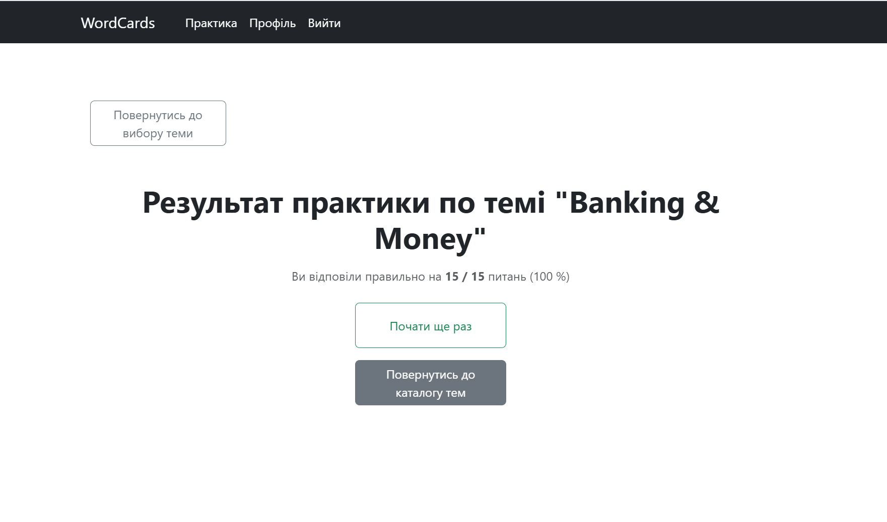
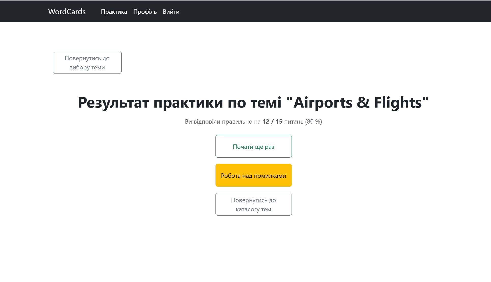

### Categories & Filtering

### Statistics & Results

## How to Use
1. Register or sign in with Google OAuth
2. Choose a category or create your own cards
3. Practice cards in either direction (UA→EN or EN→UA)
4. Review your results and repeat mistakes

## Installation

### 1. Cloning the repository
\`\`\`bash
git clone https://github.com/TMalik26/word_cards-django.git
cd word_cards-django
\`\`\`

### 2. Creating a virtual environment
\`\`\`bash
python -m venv venv
source venv/bin/activate  # На Windows: venv\\Scripts\\activate
\`\`\`

### 3. Installing dependencies
\`\`\`bash
pip install -r requirements.txt
\`\`\`

### 4. Creating .env file
\`\`\`bash
cp .env.example .env
\`\`\`
Отредактируйте `.env` с вашими параметрами:
\`\`\`

### 5. Applying migrations
\`\`\`bash
python manage.py migrate
\`\`\`

### 6. Завантаження  данных
From the root folder of the project, run the script to populate the database with data for categories, topics, and words:
\`\`\`bash
python scripts/load_vocabulary_data.py
\`\`\`

Alternatively, you can fill the database manually through the admin panel after creating a superuser.

### 7. Creating a superuser
\`\`\`bash
python manage.py createsuperuser
\`\`\`

Enter:
Username: admin
Email: admin@example.com
Password: your-secure-password

### 7. Running the development server
\`\`\`bash
python manage.py runserver
\`\`\`
The application will be available at: http://localhost:8000
Access:
Main page: http://localhost:8000
Admin panel: http://localhost:8000/admin (use superuser credentials)

## Tech Stack

- **Backend:** Django, Django REST Framework
- **Frontend:** HTML, CSS, JavaScript
- **Hosting:** Render.com
- **Authentication:** Django Auth + Google OAuth